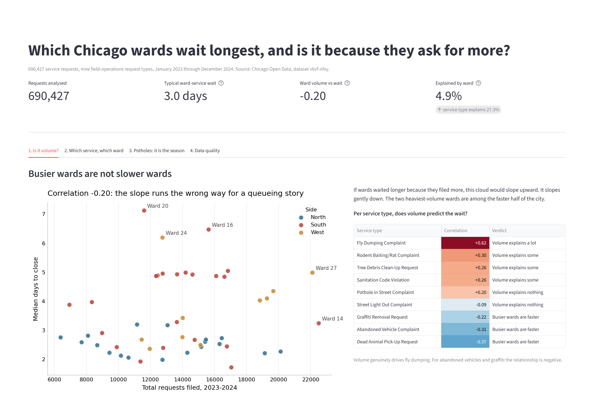
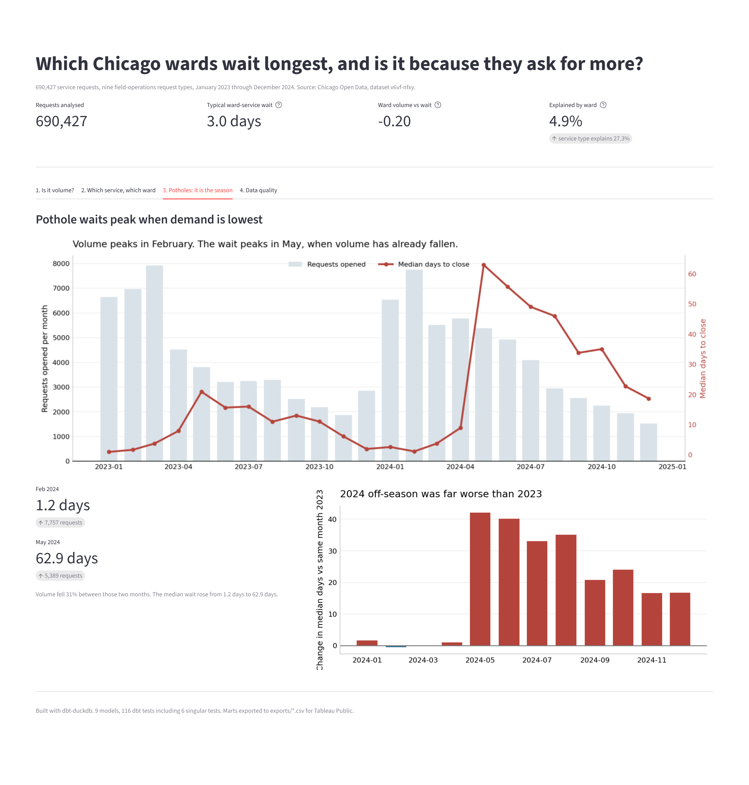
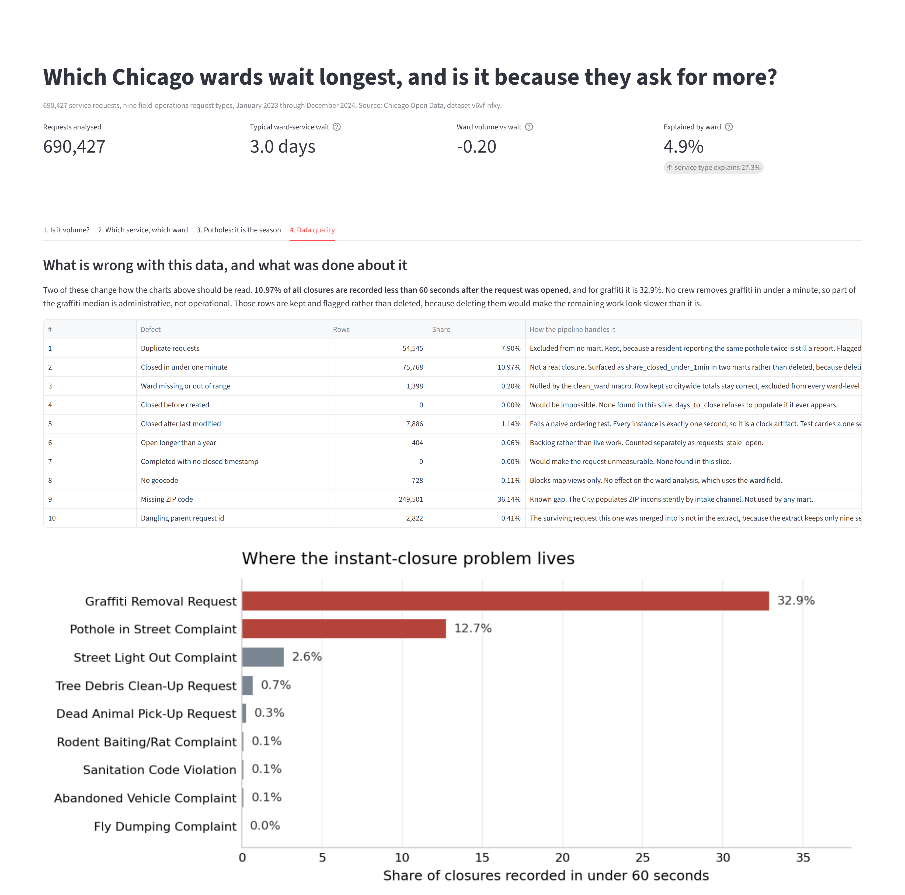

# Chicago 311: which wards wait longest, and why?

**Question.** Which Chicago wards wait longest for a 311 service request to be
closed, and is the wait explained by how much request volume the ward
generates, or by something else?

**Answer: volume explains almost none of it.** Across the 50 wards, request
volume and median wait are *negatively* correlated at **-0.20**. The busiest
wards close work fastest. Which ward you live in explains **4.9%** of the
variation in how long you wait; which service you asked for explains
**27.3%**. The delay a resident experiences is mostly about the service, and
for potholes specifically it is about the calendar month, not about queue
depth.

**Recommendation, in one line:** stop treating ward-level 311 wait times as a
capacity problem. The two fixes that would actually move the number are a
year-round pothole crew and a routing audit on West and South side sanitation
inspections. Details in [What to do about it](#what-to-do-about-it).

Built on 690,427 real service requests from the Chicago Open Data Portal,
January 2023 through December 2024.



---

## The finding in detail

### 1. Volume does not explain the wait

If wards waited longer because they filed more requests, volume and wait would
rise together. They do not.

| Measure | Value |
|---|---:|
| Correlation across 50 wards: total volume vs median wait | **-0.20** |
| Correlation within a ward: its own heavy months vs its own wait | **+0.23** |

The second number is the fairer test, because each ward acts as its own
control. It is positive, so congestion is real, but at +0.23 it is weak. A ward
having an unusually busy month moves its wait a little. A ward being a busy
ward does not move it at all, and if anything moves it the other way.

Per service type the picture splits cleanly, and this is the useful part:

| Service type | Volume vs wait (across wards) | Read |
|---|---:|---|
| Fly Dumping Complaint | **+0.62** | Volume explains a lot |
| Rodent Baiting/Rat Complaint | +0.30 | Volume explains some |
| Tree Debris Clean-Up Request | +0.26 | Volume explains some |
| Sanitation Code Violation | +0.26 | Volume explains some |
| Pothole in Street Complaint | +0.20 | Volume explains nothing |
| Street Light Out Complaint | -0.09 | Volume explains nothing |
| Graffiti Removal Request | -0.22 | Busier wards are faster |
| Abandoned Vehicle Complaint | -0.31 | Busier wards are faster |
| Dead Animal Pick-Up Request | -0.37 | Busier wards are faster |

Volume is a real constraint for exactly one thing: fly dumping, at +0.62. That
makes operational sense. Fly dumping needs a crew and a truck per site and
there is no way to batch it. Graffiti and abandoned vehicles go the other way,
because the wards that generate the most of them are the wards with standing
crews assigned.

### 2. What does explain the wait: the service, not the ward

A one-way R-squared on log closure time over 679,235 closed requests
(`dbt/analyses/variance_decomposition.sql`):

| Grouping | R-squared |
|---|---:|
| Service type only | **0.273** |
| Ward only | **0.049** |
| Service type and ward together | 0.343 |

Service type explains 5.6x more of the variation than ward does. Citywide
medians by service span a 13.2x range:

| Service type | Requests | Median days to close | P90 days |
|---|---:|---:|---:|
| Abandoned Vehicle Complaint | 94,941 | **9.89** | 29.7 |
| Pothole in Street Complaint | 100,309 | 6.01 | 91.0 |
| Rodent Baiting/Rat Complaint | 94,379 | 4.93 | 19.9 |
| Fly Dumping Complaint | 24,357 | 4.76 | 42.9 |
| Tree Debris Clean-Up Request | 56,874 | 4.08 | 26.7 |
| Sanitation Code Violation | 26,713 | 3.80 | 38.8 |
| Street Light Out Complaint | 76,861 | 2.70 | 15.9 |
| Dead Animal Pick-Up Request | 30,792 | 1.25 | 3.2 |
| Graffiti Removal Request | 185,201 | **0.75** | 2.8 |

On a request-level median, the slowest ward is **Ward 41** at 4.78 days and the
fastest is **Ward 42** in the Loop at 0.72, a 6.6x gap. Most of that gap is
service mix rather than service quality: 58.9% of Ward 42's requests are
graffiti, the fastest service in the city, against 16.5% for Ward 20. Taking
the median of each ward's nine service-level medians instead, which removes the
mix effect, narrows the city to 4.1x, from **Ward 20** at 7.13 days to **Ward
11** at 1.72. Removing the mix effect removes a third of the apparent ward
inequality, which is the first hint that the question is about services.

### 3. Where ward inequity is real

Measuring ward spread *within* a single service type, using the ratio of the
90th percentile ward median to the 10th percentile ward median, inequity is
concentrated rather than spread out. Wards with fewer than 200 closed requests
of a type are excluded, because two small wards were enough to make the raw
max/min ratio read 95x.

| Service type | Ward inequity (p90/p10) | Slowest ward | Fastest ward |
|---|---:|---|---|
| Fly Dumping Complaint | **24.3x** | Ward 27, 33.5 d | Ward 39, 0.80 d |
| Sanitation Code Violation | **21.8x** | Ward 24, 42.1 d | Ward 2, 0.44 d |
| Pothole in Street Complaint | **7.7x** | Ward 36, 20.9 d | Ward 42, 0.97 d |
| Graffiti Removal Request | 3.9x | Ward 46, 1.07 d | Ward 19, 0.0001 d* |
| Tree Debris Clean-Up Request | 3.4x | Ward 16, 7.9 d | Ward 11, 1.72 d |
| Abandoned Vehicle Complaint | 1.7x | Ward 44, 21.8 d | Ward 42, 0.93 d |
| Dead Animal Pick-Up Request | 1.5x | Ward 48, 1.9 d | Ward 37, 1.10 d |
| Rodent Baiting/Rat Complaint | 1.4x | Ward 19, 6.2 d | Ward 34, 1.82 d |
| Street Light Out Complaint | 1.4x | Ward 43, 4.2 d | Ward 40, 1.98 d |

\* Ward 19's graffiti median of 9 seconds is not a performance result. 59.5% of
its 297 graffiti requests are sub-minute batch closures, which is defect 2
below. It is the clearest single example of why that defect had to be found
before any of these rankings could be trusted.

Six of the nine services are close to equitable. Three are not, and the
geography of those three is consistent:

| Median days to close | North | South | West |
|---|---:|---:|---:|
| Fly Dumping Complaint | 1.11 | 5.88 | 2.64 |
| Sanitation Code Violation | 1.18 | 4.98 | 3.80 |
| Pothole in Street Complaint | 6.16 | 5.33 | **11.86** |

For fly dumping and sanitation code violations, the South and West sides wait
4 to 5 times longer than the North side. For fly dumping, volume accounts for
much of that (+0.62, and the South side files the most). For sanitation code
violations it accounts for less (+0.26). For potholes, the West side waits
twice as long as the rest of the city and volume explains none of it.

### 4. The pothole wait is seasonal, and it got worse

This is the clearest mechanism in the data, and it is the opposite of a
queueing story.



| Month | Requests opened | Median days to close |
|---|---:|---:|
| February 2024 | 7,757 | **1.2** |
| May 2024 | 5,389 | **62.9** |

Volume fell 31% between those two months and the median wait rose from 1.2
days to 62.9 days. Across all 24 months the correlation between monthly pothole
volume and monthly pothole wait is **-0.26**: the heaviest months are the
fastest months.

CDOT clearly runs a pothole blitz during the winter and spring pothole season
and stands the crews down afterwards. A request filed in February is fixed
inside two days. The same request filed in May waits two months.

It also got substantially worse year over year. Comparing each month to the
same month in 2023:

| Month | 2023 median | 2024 median | Change |
|---|---:|---:|---:|
| May | 20.9 d | 62.9 d | **+42.0 d** |
| June | 15.7 d | 55.8 d | +40.1 d |
| July | 16.0 d | 49.1 d | +33.0 d |
| August | 11.0 d | 46.0 d | +35.0 d |

Peak-season performance was flat or slightly better in 2024. The entire
degradation is in the off-season.

---

## What to do about it

1. **Hold a year-round pothole crew.** The pothole backlog is an off-season
   problem, not a peak-demand problem. A February request closes in 1.2 days
   and a May request takes 62.9 days on 31% less volume. Whatever capacity
   exists in February is clearly sufficient for May's volume. The 2024
   off-season was 33 to 42 days worse than 2023 at the same volume, so this is
   getting worse and is the single largest addressable wait in the dataset.

2. **Audit sanitation inspection routing on the West and South sides.** Fly
   dumping and sanitation code violations are the only two services with real
   ward inequity, at 24.3x and 21.8x between fast and slow wards. North side
   wards close both in about 1.1 days; South side wards take 5.0 to 5.9. For
   fly dumping, volume accounts for much of the gap and the honest answer is
   more crews on the South side. For sanitation code violations, volume
   correlates at only +0.26, so the gap is more likely about inspector
   assignment than headcount, and that is a routing question rather than a
   budget one.

3. **Do not fund ward-level capacity based on 311 wait times.** Ward identity
   explains 4.9% of the variation. A program that equalised ward capacity would
   be targeting the smaller half of the problem. Target the service, and for
   potholes target the month.

4. **Fix the "Mass Entry" intake channel before publishing graffiti metrics.**
   All 60,241 Mass Entry requests are graffiti, and every one is recorded as
   closed within 47 seconds of being opened. They are 33% of all graffiti
   requests and they pull the published graffiti median from 0.98 days down to
   0.75. Any public dashboard built off this field is reporting a batch-import
   timestamp as a service outcome.

---

## Pipeline

```
Chicago Open Data (Socrata API, dataset v6vf-nfxy)
  |
  |  scripts/extract.py        paginated by month, resumable, caches to data/raw/
  v
data/raw/sr_YYYY_MM_pNN.csv    24 files, 690,427 rows, 187 MB (gitignored)
  |
  |  scripts/load_raw.py       all columns land as VARCHAR on purpose
  v
raw.service_requests           DuckDB landing table
  |
  |  dbt: staging              rename and type only, lossless
  v
stg_service_requests (view)    690,427 rows
stg_wards            (view)    50 rows, from seeds/ward_reference.csv
  |
  |  dbt: intermediate         the actual work
  v
int_service_requests           690,427 rows  INCREMENTAL on last_modified_at
  dedup on sr_number, normalise status and department,
  compute days_to_close, flag 8 data-quality conditions
int_ward_monthly_load          1,200 rows (50 wards x 24 months)
  |
  |  dbt: marts                aggregated, dashboard-ready
  v
mart_ward_service_performance    450 rows
mart_service_type_summary          9 rows
mart_volume_vs_delay              10 rows
mart_monthly_trend               216 rows
mart_data_quality                 10 rows
  |
  +--> dashboard/app.py         Streamlit, reads DuckDB directly
  +--> scripts/export_marts.py  exports/*.csv, Tableau-ready headers
```

Why DuckDB: the whole warehouse is a single 200 MB file, the project needs no
cloud credentials, and a 690k row incremental model builds in 13 seconds.

**The incremental model.** `int_service_requests` is the only incremental model
in the project, and the reasoning is written at the top of the file. It is the
only model that is both large and append-mostly. Over 95% of its rows are
closed requests that will never change again. The filter is on
`last_modified_at` rather than `created_at`, because a pothole opened in March
and closed in September has to be allowed to update. Strategy is
`delete+insert` keyed on `sr_number`, so a re-pulled month replaces rows rather
than duplicating them. Measured effect on this model: **14.14s on
`--full-refresh`, 1.47s incremental**, with the row count unchanged at 690,427
and 690,427 distinct ids afterwards. For the whole project that is 23.7s cold
versus 7.1s warm.

**Macros.** Four, in `dbt/macros/`:

- `clean_ward` coerces the ward string to an integer in 1 to 50 and nulls
  anything else. Nulls rather than drops, so citywide totals stay honest while
  ward-level marts exclude the unknowns.
- `normalize_label` collapses a label to a comparison key. Written because
  `status` is spelled "Completed" 680,439 times and "Closed" once in the wider
  dataset, and `origin` has 29 spellings for about eight real intake channels.
- `duration_days` is the closure-duration arithmetic, used in the intermediate
  model, three marts and two tests. It exists so the definition of "days to
  close" cannot drift between a mart and the test guarding it. Deliberately not
  clamped at zero, because a negative value is a defect the tests need to see.
- `safe_corr` wraps Pearson correlation with a minimum row count and an
  `isfinite` guard. It exists because of a bug the clean-clone test found:
  running the project against the small committed sample left some service
  types with one ward-month observation, DuckDB's `corr()` over zero variance
  returns NaN rather than NULL, and NaN passed silently through the model and
  then failed an `accepted_range` test with a misleading message. NULL is the
  honest answer for "not enough data to say".

---

## Tests

`dbt test` runs **116 tests** and all 116 pass. Generic tests cover `not_null`,
`unique`, `accepted_values`, `relationships` from the fact table's ward to the
ward dimension, `accepted_range` on every rate and duration, and
`unique_combination_of_columns` on both composite-grain marts.

Six **singular tests** in `dbt/tests/` encode business rules found in the data:

| Test | Rule |
|---|---|
| `assert_no_closure_before_creation` | A request cannot close before it opened |
| `assert_closed_not_after_last_modified` | A record cannot close after it was last touched |
| `assert_ward_within_chicago_range` | Ward is 1 to 50 and exists in the dimension |
| `assert_closed_requests_are_measurable` | A Completed request must have a closure timestamp |
| `assert_staging_preserves_raw_rowcount` | Staging renames and types, it never filters |
| `assert_mart_volume_matches_fact` | The ward mart's volume must equal the fact table's |

### The test that failed, and what was done about it

`assert_closed_not_after_last_modified` failed on the raw data, returning
**7,886 rows of 690,427**. Before weakening it, the magnitude was measured:

```sql
select min(d), median(d), max(d) from (
  select epoch(closed_at) - epoch(last_modified_at) as d
  from main_staging.stg_service_requests
  where closed_at > last_modified_at);
-- 1.0  |  1.0  |  1.0    (seconds)
```

Every one of the 7,886 violations is exactly one second, across all nine
service types. That is a write-ordering artifact in the City's system, where
the closure timestamp and the modified timestamp are set by separate
statements. The smallest unit any mart reports is a minute, so it changes
nothing downstream.

The test was kept and given a two-second tolerance, which still catches a
genuine ordering break. The evidence and the decision are both written into the
test file, and the defect is recorded with its row count in
[docs/DATA_QUALITY.md](docs/DATA_QUALITY.md#5-closed-after-last-modified-7886-rows-114).
If the magnitude had been hours, the right call would have been to exclude the
affected requests from closure measures instead of loosening the test.

---

## Data quality

Ten defects found and documented with row counts and the SQL that found each
one. The full write-up is in
**[docs/DATA_QUALITY.md](docs/DATA_QUALITY.md)**. The same counts are also
computed by the `mart_data_quality` model, so the doc and the pipeline cannot
drift apart.



| # | Defect | Rows | Share | Handling |
|---|---|---:|---:|---|
| 1 | Duplicate requests flagged by the City | 54,545 | 7.90% | Kept and flagged. They close *slower* than non-duplicates (4.96 vs 2.16 days), so dropping them would flatter the city |
| 2 | Closures recorded in under 60 seconds | 75,768 | 10.97% | Kept and flagged. Root cause found, see below |
| 3 | Ward missing | 1,398 | 0.20% | Nulled by `clean_ward`, row kept so citywide totals stay correct |
| 4 | Closed before created | 0 | 0.00% | None here. Test retained for wider windows |
| 5 | Closed after last modified | 7,886 | 1.14% | Benign 1-second clock artifact, test given a tolerance |
| 6 | Open longer than a year | 404 | 0.06% | Reported separately as backlog, mostly street lights |
| 7 | Completed with no closure timestamp | 0 | 0.00% | None here, which is why `closure_rate` ships without a caveat |
| 8 | No geocode | 728 | 0.11% | Blocks map views only, which is one reason there is no map |
| 9 | Missing ZIP code | 249,501 | 36.14% | Documented, unrepaired, unused by any mart |
| 10 | Dangling parent request id | 2,822 | 0.41% | Artifact of my own nine-type extract filter, not a City defect |

**The one that mattered.** Defect 2 would have quietly ruined the analysis.
10.97% of all closures are recorded less than 60 seconds after the request was
opened, which no crew can do. Grouping by intake channel found the cause in one
query: all 60,241 requests with `origin = 'Mass Entry'` are graffiti requests,
and all 60,241 close within 47 seconds. It is a batch import of already-complete
work orders. It accounts for 33% of all graffiti requests, and it drags the
published medians down:

| Measure | As published | Excluding sub-minute closures |
|---|---:|---:|
| Citywide median | 2.49 d | 3.05 d |
| Graffiti median | 0.75 d | 0.98 d |
| Pothole median | 6.01 d | 8.06 d |

Those rows are kept and flagged rather than deleted, because the work did
happen and deleting it would make the remaining work look slower than it is.
`share_closed_under_1min` is published in two marts so a reader can judge the
number instead of being handed a silently cleaned one.

**Things that turned out clean**, recorded so the next person does not re-check:
`sr_number` is unique across all 690,427 rows, every timestamp parses, no
community area is outside 1 to 77, no closure timestamp is in the future, and
all nine service types map one-to-one to a single short code with no spelling
variants. The real normalisation work was in `owner_department` and `origin`,
not where it was expected.

---

## Dashboard

```bash
streamlit run dashboard/app.py
```

Four views, one per step of the argument: is it volume, which service and which
ward, the pothole seasonality, and the data quality. Screenshots in `docs/`:
[view 1](docs/dashboard.png), [view 2](docs/dashboard_tab2.png),
[view 3](docs/dashboard_tab3.png), [view 4](docs/dashboard_tab4.png).

Every mart is also exported to `exports/*.csv` with title-case headers and no
index column, for a Tableau Public version of the same analysis.

---

## Reproduce from a clean clone

```bash
git clone <repo-url> && cd chicago-311-analytics
pip install -r requirements.txt

./run.sh                 # extract, load, dbt run, dbt test, docs, export
streamlit run dashboard/app.py
```

`run.sh` is the whole pipeline. It takes about 15 minutes on a cold start, most
of which is the 187 MB API pull, and about 40 seconds if `data/raw/` is already
populated. Two shortcuts:

```bash
./run.sh --skip-extract   # reuse whatever is in data/raw/
./run.sh --quick          # build off the committed 2,400 row sample, no download
```

`--quick` exists so the models and all 116 tests can be exercised in under a
minute without downloading anything. It uses `data/sample/sr_sample.csv`, which
is committed. The numbers in this README come from the full 690,427 row pull.

Both paths were verified by copying the repo to a temporary directory, deleting
everything `.gitignore` excludes, and rebuilding. `--quick` built 9 models and
passed 116 tests off the 2,400 row sample with no network access. The
full-volume rebuild took 1 minute 58 seconds end to end and produced
`exports/*.csv` files byte-identical to the ones in this repo, which is what
the export sort keys in `scripts/export_marts.py` are there to guarantee.

The dbt CLI is not on PATH on the machine this was built on, so `run.sh`
prepends the Windows Store Python scripts directory and falls back to
`python -m dbt.cli.main` if that does not resolve. To run dbt by hand:

```bash
cd dbt
export PATH="/c/Users/HP/AppData/Local/Packages/PythonSoftwareFoundation.Python.3.13_qbz5n2kfra8p0/LocalCache/local-packages/Python313/Scripts:$PATH"
dbt deps && dbt seed && dbt run && dbt test
```

`profiles.yml` lives in the `dbt/` directory and points at `../data/chicago311.duckdb`
by relative path, so no environment variables or credentials are needed.

Generated dbt docs are committed. Open `dbt/target/index.html` for the column
documentation and the lineage graph without installing dbt.

### Verified output

Output of `./run.sh --skip-extract` against an empty warehouse:

```
raw.service_requests: 690,427 rows, 20 columns

$ dbt seed
Done. PASS=1 WARN=0 ERROR=0 SKIP=0 NO-OP=0 REUSED=0 TOTAL=1

$ dbt run
Found 9 models, 116 data tests, 1 seed, 1 analysis, 1 source, 620 macros
Finished running 1 incremental model, 6 table models, 2 view models in 23.74s
Completed successfully
Done. PASS=9 WARN=0 ERROR=0 SKIP=0 NO-OP=0 REUSED=0 TOTAL=9

$ dbt test
Finished running 116 data tests in 14.16s
Completed successfully
Done. PASS=116 WARN=0 ERROR=0 SKIP=0 NO-OP=0 REUSED=0 TOTAL=116

$ dbt docs generate
Catalog written to dbt/target/catalog.json

$ python scripts/export_marts.py
mart_ward_service_performance -> ward_service_performance.csv   450 rows, 18 cols
mart_service_type_summary     -> service_type_summary.csv         9 rows, 22 cols
mart_volume_vs_delay          -> volume_vs_delay.csv             10 rows,  7 cols
mart_monthly_trend            -> monthly_trend.csv              216 rows, 14 cols
mart_data_quality             -> data_quality.csv                10 rows,  7 cols
EXPORT COMPLETE: 5 files, 695 rows total into exports
```

Row counts: `stg_service_requests` 690,427 | `stg_wards` 50 |
`int_service_requests` 690,427 | `int_ward_monthly_load` 1,200 |
`mart_ward_service_performance` 450 | `mart_service_type_summary` 9 |
`mart_volume_vs_delay` 10 | `mart_monthly_trend` 216 | `mart_data_quality` 10

---

## Data source

City of Chicago 311 Service Requests, dataset id **`v6vf-nfxy`**, from
`data.cityofchicago.org`. Public, no authentication, no API key.

The full dataset holds 3,694,938 requests for 2023-2024. This project uses
690,427 of them, filtered to nine field-operations request types. The two
largest categories in the raw feed are excluded on purpose: "311 INFORMATION
ONLY CALL" (1,344,602 rows) is a phone log entry with no work attached, and
"Aircraft Noise Complaint" (652,015 rows) is handled by Aviation and is not
ward-serviced. Together they are 54% of the feed and neither can answer a
question about how long a ward waits for work to get done. The nine types kept
are graffiti removal, potholes, rodent baiting, abandoned vehicles, street
lights out, tree debris clean-up, dead animal pick-up, sanitation code
violations and fly dumping.

---

## Limitations

- **The service-mix confound is not fully removed.** Ward and service type are
  correlated: a ward with more alleys files more fly-dumping complaints. The
  R-squared figures are descriptive one-way decompositions, not a causal
  estimate, and the ward and service numbers do not sum to the joint figure for
  exactly that reason. A fixed-effects model with ward-level covariates for
  road mileage, alley mileage and housing density would be the right next step.
  None of those covariates are in this dataset.

- **Correlation, not causation, throughout.** The pothole seasonality result is
  the strongest claim here and it is still only a correlation plus an
  operational story that fits it. Confirming it would need CDOT crew
  deployment data, which is not published.

- **Closure timestamp means "case closed", not "problem fixed".** A request can
  be closed because the work was done, because it was a duplicate, because the
  address was wrong, or because it was transferred. The dataset does not
  distinguish these. The Mass Entry finding is one visible edge of this
  problem; there are probably others that are not as detectable.

- **Nine service types, not all of them.** The conclusion that service type
  dominates ward is measured across these nine. A different nine, especially
  inspection-heavy types like building violations, could shift the balance.

- **Wards were redistricted effective 2023.** The ward boundaries in force
  during this window are the post-2022-remap boundaries, so ward numbers here
  are consistent across the two years, but they are not comparable to
  pre-2023 Chicago 311 analyses.

- **The North/South/West grouping is mine, not the City's.** The
  `ward_reference` seed assigns each ward to a side based on the ward map. The
  City's own operational districts for Streets and Sanitation do not line up
  exactly with ward boundaries, so the side-of-city numbers are indicative
  rather than official.

- **The 200-request floor on ward spread is a judgement call.** Without it, two
  wards with a handful of closed fly-dumping requests pushed the reported
  inequity ratio to 95x. With it, the figure is 24.3x. The floor is in the SQL
  and easy to change, but it does move the headline number.

- **`days_open` and `is_stale_open` are measured against a fixed date**,
  2025-01-01, rather than today. That keeps the published numbers stable across
  re-runs at the cost of being a snapshot rather than a current view.

- **Single local warehouse.** DuckDB on one machine with no orchestration, no
  CI, and no scheduled refresh. Those would be the first things to add before
  anyone relied on this.
